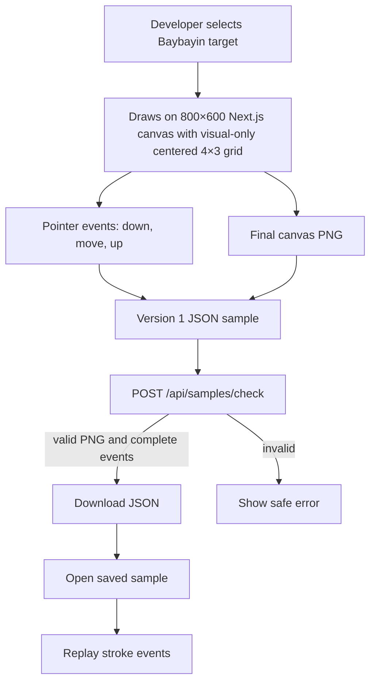
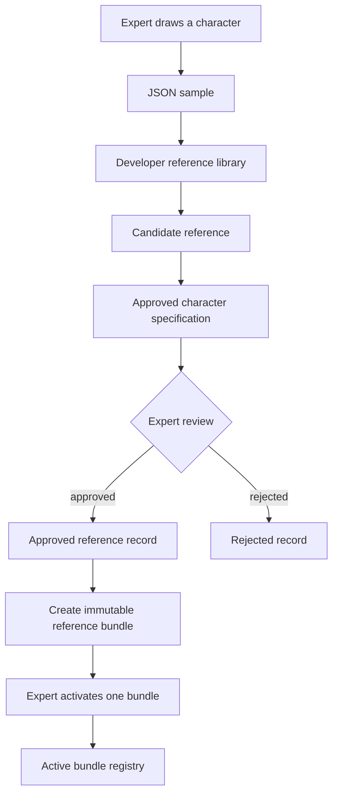
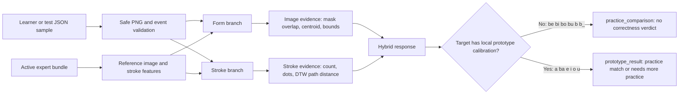
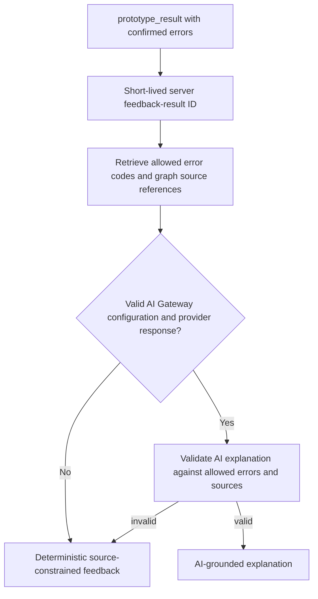
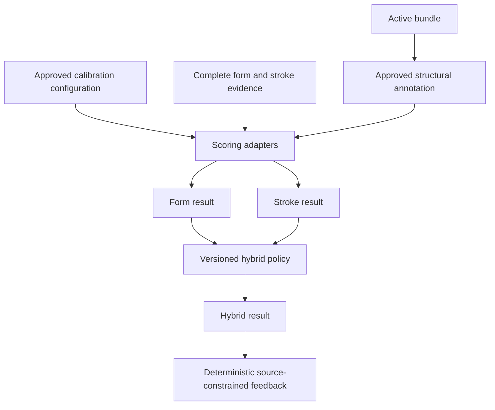
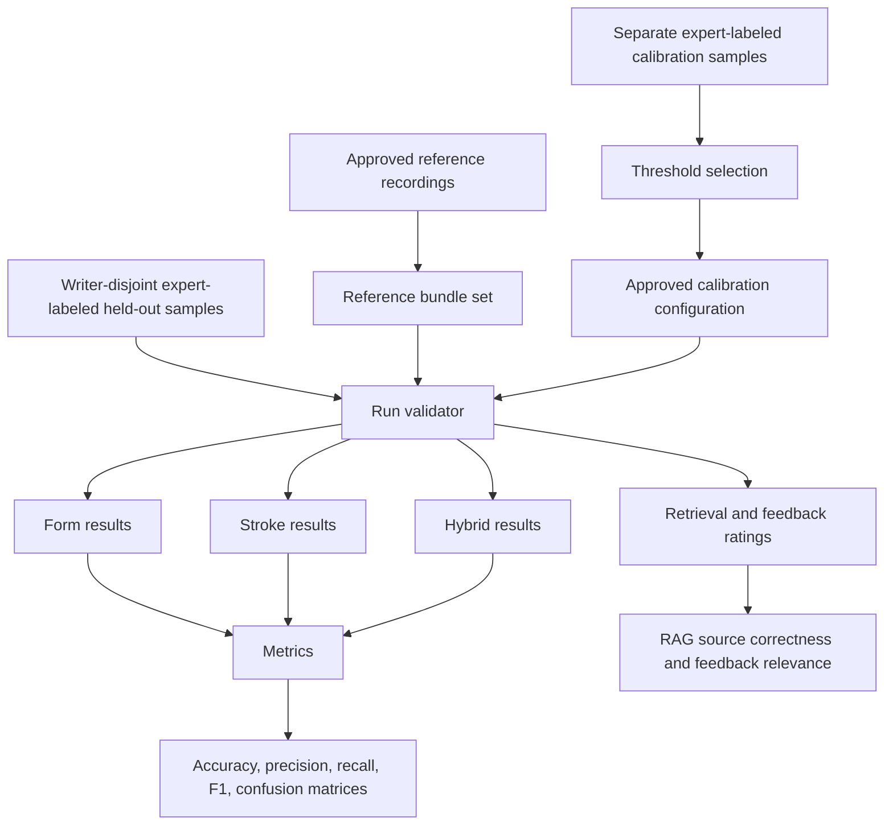

# System flow

This document shows how data moves through the Baybayin validator prototype. It is written for group members who need to know where their work belongs.

## 1. Capture and replay flow

The downloaded JSON is the main interchange file during development. It contains both the final image and the ordered stroke events. It is not a learner result.

## 2. Expert-reference workflow

### Meaning of each state

| State | Meaning | Can preview use it? |
|---|---|---:|
| Candidate record | Imported sample awaiting review. | No |
| Approved record | Expert-reviewed sample tied to an approved specification. | Not by itself |
| Approved bundle | Derived image and stroke features exist. | No, activation still required |
| Active bundle | The single approved reference explicitly selected for that target. | Yes, for provisional evidence |
| Superseded record | Old approved reference replaced by a later decision. | No |

The system preserves older bundles and records for research auditability. It does not overwrite them.

## 3. Current learner comparison and prototype-scoring flow

### Form branch

The form branch compares the completed PNG images after normalizing visible ink onto the same-sized square canvas. It calculates measurements such as image-mask overlap and centroid distance.

### Stroke branch

The stroke branch keeps pen-lift boundaries. It compares normal path strokes using constrained Dynamic Time Warping (DTW). A stationary dot is compared by normalized position instead of DTW.

### What the learner state means

All 12 current-release targets have an active local expert comparison bundle. A numeric DTW distance or image overlap is not automatically a research-grade “correct” or “incorrect” result.

- `a`, `ba`, `e`, `i`, `o`, and `u` have local **prototype** form/DTW limits derived from accepted `ajstrokes` and `hurry-strokes` recordings. These enable practice results, not thesis accuracy claims.
- `be`, `bi`, `bo`, `bu`, `b`, and `b_` lack a calibration configuration. They return `practice_comparison` even though the expert recording is used for comparison.

Kudlit/cancellation marks may be outside the visual grid. Full-canvas placement can be checked only when an approved target-specific annotation exists; it is not yet a completed calibrated check for every modified target.

## 4. Feedback flow

AI is optional wording only. It receives no learner image, pointer events, expert recording, reviewer data, bundle ID, or threshold value. It cannot decide correctness or add an error.

## 5. Future expert-calibrated scoring flow

A future score requires all of the following:

1. An active expert bundle for the target.
2. An approved structural annotation linked to that exact bundle.
3. An approved calibration configuration linked to that exact bundle.
4. Complete evidence for each expected path or dot stroke.

If any item is missing, the system must return an unavailable or needs-review state instead of a pass/fail result.

## 6. Chapter 3 and Chapter 4 evaluation flow

- **Chapter 3** explains this methodology, the data partitions, and the metrics.
- **Chapter 4** reports the measured results after expert-labeled evaluation data exists.

Never use the same writer’s samples in both threshold tuning and held-out evaluation. Never treat synthetic development samples as professional ground truth.

## 7. Where group members should work

| If you are working on… | Start with… |
|---|---|
| Learner drawing/canvas behavior | `app/frontend/app/learn/learner-practice.js` and `app/frontend/lib/capture.js` |
| Developer capture | `app/frontend/app/drawing-canvas.js` and `app/frontend/lib/capture.js` |
| Replay/import behavior | `app/frontend/app/recording-review.js` and `app/frontend/lib/review.js` |
| Developer reference workflow | `app/frontend/app/developer-reference-library/reference-library.js` and `app/backend/reference_library.py` |
| API behavior and request validation | `app/backend/main.py` |
| Image-form comparison | `app/backend/multimodal.py` and `app/backend/form_matching.py` |
| DTW/stroke comparison | `app/backend/stroke_matching.py` and `app/backend/stroke_rules.py` |
| Calibration and hybrid scoring | `app/backend/validation_config.py`, `app/backend/scoring.py`, and `app/backend/prototype_calibration.py` |
| Feedback and optional AI phrasing | `app/backend/feedback.py`, `app/backend/feedback_store.py`, `app/backend/ai_feedback.py`, and `app/backend/ai_provider.py` |
| Knowledge source data | `knowledge-graph/` — change only with source references and team review |
| Tests | The matching file in `app/backend/tests/` or `app/frontend/test/` |
| Thesis evaluation data | `app/evaluation/` and `app/backend/evaluation_metrics.py` |

## 8. Rules for contributors

1. Write or update a test before changing validation behavior.
2. Do not commit files from `app/data/reference-library/`.
3. Do not edit the knowledge graph through the browser.
4. Do not call provisional measurements a validation score.
5. Preserve source references, reviewer codes, bundle IDs, and configuration versions in any new validation output.
6. Add a file entry to `docs/FILE_REFERENCE.md` when adding a maintained file.
